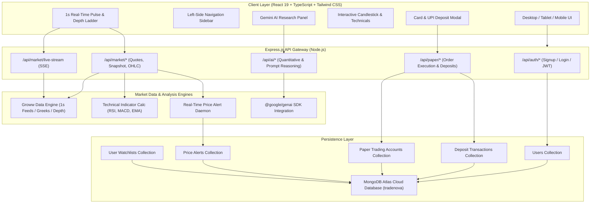
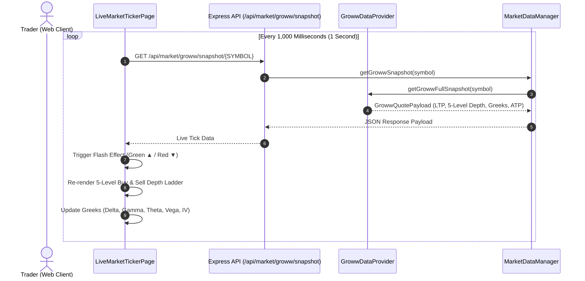
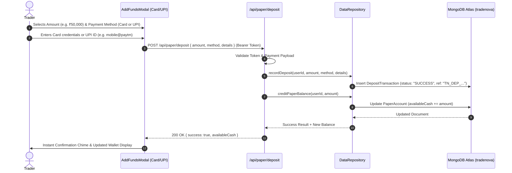

<div align="center">

# 🚀 TradeNova
### Next-Gen Indian Stock Trading Terminal & AI Quantitative Research Hub

[](https://ais-dev-wqztmcv6ojcqoyxtthflcj-462396132781.asia-east1.run.app)
[](https://react.dev/)
[](https://www.typescriptlang.org/)
[](https://tailwindcss.com/)
[](https://nodejs.org/)
[](https://expressjs.com/)
[](https://www.mongodb.com/atlas)
[](https://ai.google.dev/)
[](LICENSE)

<br/>

**TradeNova** is an institutional-grade, full-stack Indian stock market intelligence platform. Designed for modern traders, it delivers 1-second real-time market data ticks, 5-level buy/sell order book depth ladders, official derivatives Greeks, interactive technical charting, virtual paper trading with Card & UPI funds deposits, and automated quantitative research powered by Google Gemini AI.

---

### 🌐 Live Application
🔗 **[Launch TradeNova Live App](https://ais-dev-wqztmcv6ojcqoyxtthflcj-462396132781.asia-east1.run.app)**  
*(Custom production domain URL will be updated here post deployment)*

---

</div>

<br/>

## 📸 Application Preview

```
+--------------------------------------------------------------------------------------------------------------------+
|  TRADENOVA TERMINAL  |  NIFTY 50: 25,120.45 (+0.45%)  |  SENSEX: 82,340.20 (+0.48%)  |  Trading Balance: ₹10,50,000 |
+--------------------------------------------------------------------------------------------------------------------+
| [SIDEBAR NAVIGATION] |  1-SECOND REAL-TIME TICKER (Groww API Feed Engine)                                          |
|                      |  ------------------------------------------------------------------------------------------ |
| * Market Overview    |  [RIL] RELIANCE INDUSTRIES LIMITED  •  NSE CASH               [ LTP: ₹2,711.35  ▲ +1.45% ]  |
| * 1s Real-Time Pulse |  ATP: ₹2,709.80  | High: ₹2,745.00  | Low: ₹2,692.10 | Upper Circuit: ₹2,982 | Lower: ₹2,440 |
| * Stock Explorer     |  ------------------------------------------------------------------------------------------ |
| * Paper Trading      |  5-LEVEL MARKET DEPTH LADDER                  | OPTION GREEKS (FNO DERIVATIVES)             |
| * Add Funds (Card/UPI|  BUY ORDERS (BID)       | SELL ORDERS (ASK)   | Delta: 0.542   | Gamma: 0.0018              |
| * Price Alerts       |  ₹2,711.20 (2,580 qty)  | ₹2,711.50 (2,390 qty)| Theta: -6.45   | Vega:  12.35               |
| * Gemini AI Analyst  |  ₹2,710.80 (2,030 qty)  | ₹2,711.90 (2,000 qty)| Rho:   2.14    | IV:    14.80%              |
| * Holdings Ledger    |  Total Bids: 7,962      | Total Asks: 7,656   | Open Interest: 4,50,000 (+2.85%)            |
| * Watchlists         |  ------------------------------------------------------------------------------------------ |
| * Settings & Theme   |  INTERACTIVE TECHNICAL CHART (Candlestick / OHLC / EMA 20/50 / RSI 14 / MACD Oscillator)    |
+--------------------------------------------------------------------------------------------------------------------+
```

<br/>

## ⚡ Core Features & Capabilities

### 1. ⏱️ 1-Second Real-Time Market Ticker & Order Depth
- Adheres to **Groww API cURL specifications** (`/live-data/quote`, `/live-data/ltp`, `/live-data/ohlc`, and option chain).
- Real-time tick flashing (green on upward tick, red on downward tick).
- **5-Level Buy vs Sell Order Book Ladder** displaying live bid quantities, ask prices, order counts, and relative depth visual bars.
- Complete **Option Greeks Engine**: real-time calculation and display of Delta ($\Delta$), Gamma ($\Gamma$), Theta ($\Theta$), Vega ($\nu$), Rho ($\rho$), and Implied Volatility (IV).

### 2. 🏛️ Curated Universe of 260+ Verified Indian Equities
- Complete coverage of National Stock Exchange of India (NSE) & Bombay Stock Exchange (BSE).
- Filterable across **35+ recognized economic sectors** (Banking, IT, Automotive, Pharma, Energy, FMCG, Defence, Infrastructure, etc.).
- Categorized by SEBI classification: **Large-Cap**, **Mid-Cap**, and **Small-Cap**.
- **Company Branding**: Visual logos and avatar badges alongside official registered company names for intuitive recognition.

### 3. 💳 Virtual Paper Trading & Instant Funds Deposit Gateway
- Realistic capital account simulation with SEBI-compliant paper balance.
- **Add Funds via Card & UPI**:
  - **Cards**: Debit/Credit Card checkout simulation (Visa, Mastercard, RuPay) with 16-digit card validation, expiry, and CVV checks.
  - **UPI Gateway**: Instant fund transfer using Google Pay, PhonePe, Paytm, BHIM, or custom VPA handle (`username@bank`).
  - **Net Banking**: Direct top-ups from top Indian scheduled commercial banks.
- Real-time wallet balance crediting with a persistent transaction ledger saved directly to MongoDB Atlas.

### 4. 📈 Interactive Financial Candlestick Charts & Technical Indicators
- Multi-timeframe analysis: **1D (Intraday 5m)**, **1W**, **1M**, **1Y**, **5Y**, and **All-Time**.
- Multiple chart visualization modes: Japanese Candlesticks, Clean Line, Area Mountain, and OHLC Bars.
- Quantitative indicator overlays:
  - Exponential Moving Averages (EMA 20, 50, 200)
  - Relative Strength Index (RSI 14) with dynamic overbought/oversold bands
  - Moving Average Convergence Divergence (MACD 12, 26, 9)
  - Bollinger Bands ($\pm 2\sigma$) and Volume histograms.

### 5. 🧠 Google Gemini AI Quant Market Analyst
- On-demand AI stock research: generates structured fundamental insights, SWOT breakdown, valuation multiples, and risk factors.
- Multi-turn interactive financial assistant: ask complex questions like *"Analyze Reliance's telecom vs retail EBITDA margin trajectory"* or *"How does HDFC Bank benefit from recent RBI policy updates?"*.

### 6. 🔔 Real-Time Price Alert Engine
- Set instantaneous price threshold alerts: `Price Rises Above (>=)` or `Price Drops Below (<=)`.
- In-app toast banner alerts with customizable audio chime notification.
- Monitored persistently on every market tick.

### 7. 🎨 Responsive Modern UI & Dynamic Theme Switcher
- Responsive left sidebar layout engineered for desktop, tablet, and mobile views.
- Seamless Dark Mode & Light Mode support with custom Tailwind CSS v4 variants.

---

<br/>

## 🛠️ Tech Stack & Technologies

| Layer | Technologies & Badges | Purpose |
| :--- | :--- | :--- |
| **Frontend Framework** |   | Modern reactive component architecture with strict end-to-end type safety |
| **Styling & Design** |  | Utility-first responsive design, dark mode theme variants, zero-latency rendering |
| **Build Tool** |  | Lightning-fast HMR and optimized production asset bundling |
| **Backend Runtime** |   | RESTful API routes, SSE market streams, and background task orchestrators |
| **Database & ORM** |   | Cloud NoSQL document store for users, accounts, deposits, watchlists, & alerts |
| **Security & Auth** |   | Stateless cryptographic session tokens, salted password hashing |
| **AI Quantitative Intelligence**|  | Institutional-grade equity research and natural language market reasoning |
| **Market Data Feeds** |  | Real-time quote snapshots, LTP, OHLC, 5-level market depth, and Option Greeks |

---

<br/>

## 🏗️ System Architecture & Data Flow



<br/>

### 🔄 Real-Time 1-Second Market Tick Flow



<br/>

### 💳 Payment & Instant Funds Deposit Workflow



---

<br/>

## 📁 Repository Directory Structure

```text
tradenova/
├── .env.example                     # Environment configuration template
├── metadata.json                    # Application metadata & permissions
├── package.json                     # Project manifest and scripts
├── server.ts                        # Full-stack server entry point
├── tsconfig.json                    # TypeScript compiler configuration
├── vite.config.ts                   # Vite client build configuration
│
├── server/                          # Backend Services & API Gateway
│   ├── ai/                          # Quantitative analysis & Gemini AI integration
│   │   ├── geminiAssistant.ts       # Stock analyst and conversational assistant
│   │   └── quantEngine.ts           # Technical indicators (RSI, MACD, EMA, BB)
│   ├── data/                        # Static seeds & reference securities
│   │   └── indianStocksSeed.ts      # 260+ curated NSE/BSE stocks with ISIN
│   ├── db/                          # Database connection & persistence
│   │   ├── connection.ts            # MongoDB Atlas connection manager & fallback
│   │   └── store.ts                 # DataRepository for users, deposits, alerts
│   ├── market-data/                 # Market data providers & adapters
│   │   ├── adapters/
│   │   │   ├── GrowwDataProvider.ts # Groww cURL API implementation (1s feed)
│   │   │   ├── TrueDataProvider.ts  # TrueData enterprise real-time adapter
│   │   │   ├── KiteConnectProvider.ts# Zerodha Kite Connect adapter
│   │   │   ├── YahooFinanceProvider.ts# Yahoo Finance fallback feed
│   │   │   └── DemoDataProvider.ts  # High-frequency fallback engine
│   │   ├── MarketDataManager.ts     # Central provider switcher & cache manager
│   │   ├── indianMarketCalendar.ts  # NSE trading hours & holiday calculator
│   │   └── types.ts                 # Domain market quote & candle interfaces
│   ├── models/                      # Mongoose schemas
│   │   └── schemas.ts               # User, Deposit, PaperAccount, Alert models
│   ├── routes/                      # API router
│   │   └── api.ts                   # Express endpoints (auth, market, paper, ai)
│   └── services/                    # Background daemon services
│       └── AlertEngine.ts           # Real-time price alert trigger worker
│
└── src/                             # Frontend React 19 Application
    ├── components/                  # Modular UI components
    │   ├── AddFundsModal.tsx        # Card & UPI payment deposit modal
    │   ├── AppHeader.tsx            # Clean header with balance & auth controls
    │   ├── AppSidebar.tsx           # Left-side primary navigation bar
    │   ├── AuthModal.tsx            # Sign in & Registration modal
    │   ├── CompanyLogo.tsx          # Brand visual logo generator with badges
    │   ├── InteractiveChart.tsx     # Candlestick / technical indicator chart
    │   ├── OrderTicketModal.tsx     # Virtual order placement modal
    │   ├── PriceAlertModal.tsx      # Set price threshold alert modal
    │   └── TopMarketBar.tsx         # Live ticker marquee
    ├── context/                     # Application state providers
    │   └── AppContext.tsx           # User auth, wallet balance, and theme state
    ├── pages/                       # Route pages
    │   ├── AIResearchPage.tsx       # Gemini AI quantitative report view
    │   ├── HoldingsPage.tsx         # User portfolio holdings & P&L breakdown
    │   ├── LiveMarketTickerPage.tsx # 1-second Groww live pulse & depth ladder
    │   ├── OverviewPage.tsx         # Market overview, gainers, losers, news
    │   ├── PaperTradingPage.tsx     # Virtual trade execution & open orders
    │   ├── PriceAlertsPage.tsx      # Active alert management
    │   ├── SettingsPage.tsx         # User profile, DB config, and preferences
    │   ├── StockDetailPage.tsx      # Comprehensive security snapshot
    │   ├── StockExplorerPage.tsx    # 260+ stock screener with sector filters
    │   ├── TradingJournalPage.tsx   # Performance metrics and trade logs
    │   └── WatchlistsPage.tsx       # Custom watchlist curator
    ├── utils/                       # Financial formatters
    │   └── formatters.ts            # Indian currency (₹ Lakh / Cr) & percent format
    ├── index.css                    # Tailwind CSS v4 directives & dark variants
    └── main.tsx                     # React client mounting entry
```

---

<br/>

## 🚀 Getting Started Locally

### Prerequisites
- **Node.js**: `v20.0.0` or higher
- **npm**: `v10.0.0` or higher
- **MongoDB**: MongoDB Atlas connection URI or local MongoDB instance

### 1. Clone the Repository
```bash
git clone https://github.com/your-username/tradenova.git
cd tradenova
```

### 2. Install Dependencies
```bash
npm install
```

### 3. Configure Environment Variables
Copy the `.env.example` file to `.env`:
```bash
cp .env.example .env
```

Edit `.env` with your credentials:
```env
# MongoDB Atlas Connection URI
MONGODB_URI="mongodb+srv://<username>:<password>@cluster0.abcde.mongodb.net/tradenova?retryWrites=true&w=majority"

# JWT Secret for Session Management
JWT_SECRET="your_secure_jwt_secret_key"

# Gemini API Key (Optional for AI Research features)
GEMINI_API_KEY="your_gemini_api_key"

# Market Data Provider ('GROWW' | 'DEMO' | 'TRUEDATA' | 'KITE' | 'YAHOO')
MARKET_DATA_PROVIDER="GROWW"
GROWW_ACCESS_TOKEN=""

# Server Port
PORT=3000
```

### 4. Start Development Server
```bash
npm run dev
```
Open your browser and navigate to `http://localhost:3000`.

### 5. Build for Production
```bash
npm run build
npm start
```

---

<br/>

## 📄 License

Distributed under the **MIT License**. See [`LICENSE`](LICENSE) for more information.

```
MIT License

Copyright (c) 2026 Sonu Kumar

Permission is hereby granted, free of charge, to any person obtaining a copy
of this software and associated documentation files (the "Software"), to deal
in the Software without restriction, including without limitation the rights
to use, copy, modify, merge, publish, distribute, sublicense, and/or sell
copies of the Software, and to permit persons to whom the Software is
furnished to do so, subject to the following conditions:

The above copyright notice and this permission notice shall be included in all
copies or substantial portions of the Software.
```

---

<br/>

## 👨‍💻 Author & Developer

<div align="center">

### **Sonu Kumar**
*Full-Stack Engineer & FinTech Systems Architect*

[](mailto:sonukr7435@gmail.com)
[](https://animated-portfolio-pro.vercel.app/)
[](https://www.linkedin.com/in/sonu-kumar-3234bb344/)

<br/>

*Designed and engineered with passion for high-frequency algorithmic finance, quantitative modeling, and modern web architectures.*

⭐ **If you find TradeNova useful, please consider giving this repository a star!** ⭐

</div>
